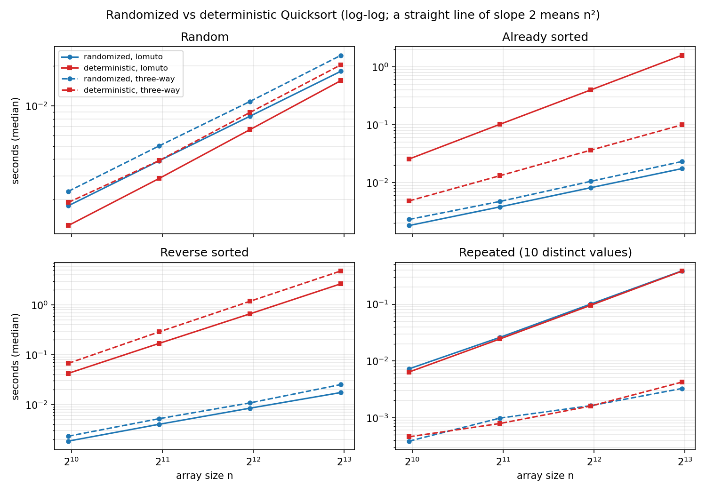
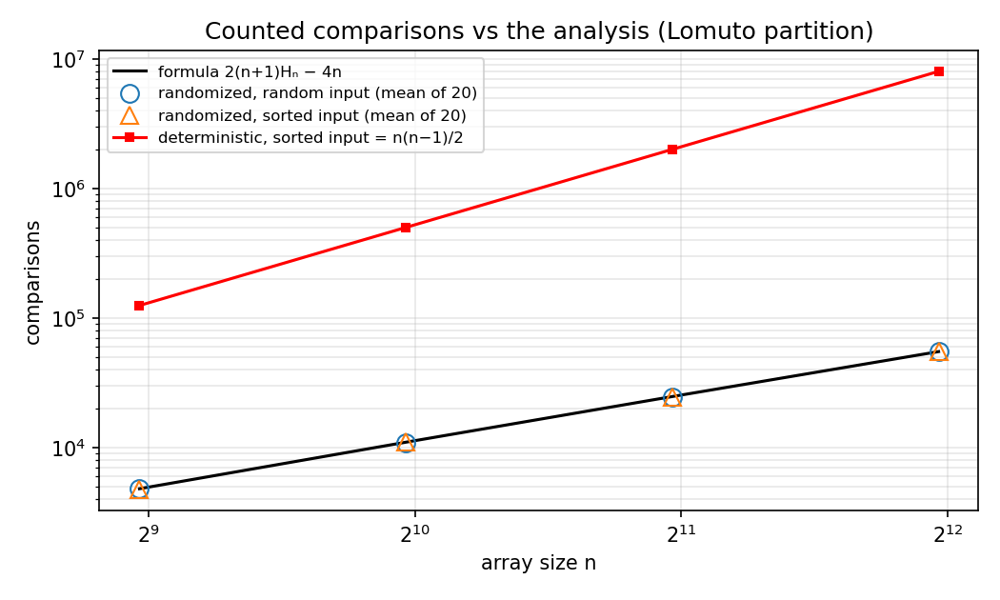
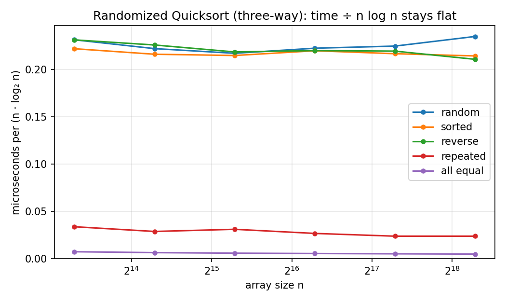
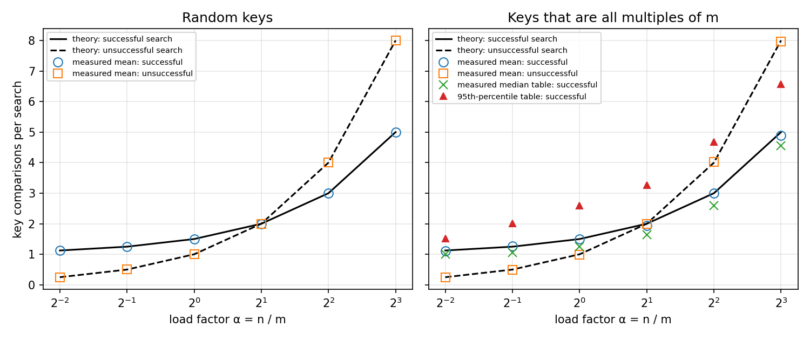
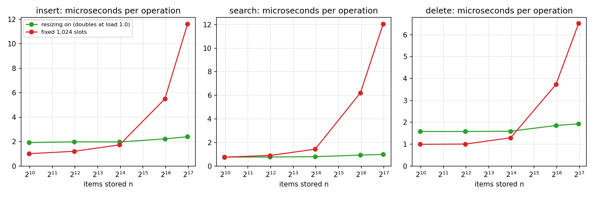

# Assignment 3: Understanding Algorithm Efficiency and Scalability

Samrat Kafle · MSCS-532 Algorithms and Data Structures · University of the Cumberlands · November 9, 2026

This report covers two algorithms: Randomized Quicksort (Part 1) and a hash table with chaining (Part 2). Each part has the implementation, a written analysis, and experiments that test the analysis. Everything here can be reproduced with the scripts in this repository (see `README.md`). Every number in the tables and text below comes from the files in `results/` (each experiment script writes its own file); the few that come from the test suite or from `results/mutation_check.txt` are labelled as such.

## Summary

- Randomized Quicksort does about 2(n+1)Hₙ − 4n comparisons on distinct keys, which is O(n log n), and it does that for **every** input order. I counted comparisons for n up to 4,000 and the measured average over 20 runs was within about 1% of that formula (about one standard error) for random input and for already-sorted input.
- Quicksort with the first element as pivot is quadratic on sorted and reverse-sorted input with the textbook partition. At n = 8,000 it took 1.58 s on sorted input and 2.66 s on reverse-sorted input, against 0.017 s for the randomized version.
- On random input the deterministic version was actually faster than the randomized one: by 32% at n = 1,000, shrinking to 15% at n = 8,000 (textbook partition). A separate check with 30 different seeds shows pivot luck changes one run's time by only about 4 to 7%, so the gap is real. Randomness costs something when there is nothing to protect against.
- Repeated values are a separate problem that randomization does **not** fix. With only 10 distinct values the textbook partition took 0.386 s (randomized) and 0.382 s (deterministic) at n = 8,000. A three-way partition brought that to 0.003 s.
- The hash table's average search cost followed the textbook formulas closely: 1 + α/2 comparisons for a successful search and α for an unsuccessful one, where α = n/m is the load factor. With dynamic resizing, cost per operation stayed almost flat from 1,000 to 128,000 items (search: 0.76 to 0.99 microseconds). A fixed 1,024-slot table went from 0.76 to 12.04 microseconds per search over the same range, about 12 times slower than the resizing table at 128,000 items.
- One result surprised me. For keys that all share the same remainder mod m, the *average* over random hash functions matched theory, but individual tables varied a lot. About 1 table in 30 was more than twice as slow as the bound.
- Two limits of the hash table that I only found through review: the universal guarantee holds for keys whose Python `hash()` values differ (in CPython -1 and -2 hash alike, so they collide under every random function), and a shrink limit close to the grow limit makes the table rebuild on almost every operation (3,999 rebuilds moving 16.4 million items in a 4,000-operation test). The constructor now rejects shrink limits above max/4.

## 0. How the experiments were run

- **Machine:** AMD Ryzen 7 3700X, Windows 11, Python 3.13.9 (details in `results/environment.txt`). The scripts use one core.
- **Timing:** wall-clock time with `time.perf_counter()`. Each value is the **median** of up to 5 runs. A cell that was slow stops after about 15 seconds of total running time, so the slowest cells have 4 runs. The array is copied before the clock starts, and every result is checked against Python's `sorted()`. The randomized runs reuse seed 532 for all repeats, so that median averages timing noise and not pivot luck; experiment D (30 seeds) measures pivot luck separately (section 1.3).
- **Inputs:** fixed random seeds, so a rerun builds the same arrays. Five kinds: *random* (distinct integers in random order), *sorted*, *reverse-sorted*, *repeated* (integers from 0 to 9, so each value appears about n/10 times) and *all equal* (an extra extreme case).
- **Two partition schemes**, both implemented. **Lomuto** is the textbook two-way partition (smaller-or-equal on the left, larger on the right). **Three-way** splits the array into smaller, equal and larger. I explain why I needed both in section 1.3.
- **A caution about Python:** every comparison and loop step costs far more in pure Python than in a compiled language, so the absolute times are not comparable with C or Java. The *shapes* of the curves are what the experiments are for.

---

## Part 1: Randomized Quicksort

### 1.1 Implementation

The code is in `randomized_quicksort.py`. Both `randomized_quicksort` and `deterministic_quicksort` sort a list in place, and they share all their code except one line: how the pivot is picked.

- **Randomized:** the pivot index is `rng.randint(lo, hi)`, uniform over the subarray being partitioned (both ends included). Passing a seeded `random.Random` makes a run repeatable.
- **Deterministic:** the pivot is always the first element, `a[lo]`.

Three details matter for efficiency and edge cases:

1. **Recursion only goes into the smaller side.** The larger side is handled by the `while` loop. That keeps the stack about log₂ n deep even when the splits are very lopsided. My first instinct was plain recursion on both sides, but a sorted array of 3,000 numbers would then hit Python's default recursion limit of 1,000 with the first-element pivot. The tests check exactly that case.
2. **Two partition schemes** (`partition="lomuto"` or `"three_way"`, with three-way as the default). Section 1.3 shows why the default has to be three-way if arrays with repeated elements are supposed to be handled efficiently.
3. **Edge cases:** empty list, one element, two elements, all equal, already sorted, reverse sorted, few distinct values, negatives, floats and strings.

Testing (`python -m unittest -v` runs all 51 tests in `test_quicksort.py`, `test_hash_table.py` and `test_counting.py`):

- every sorter is compared with `sorted()` on the edge cases above and on 150 random arrays per sorter;
- a recording stand-in for the random generator checks that the pivot index is always inside the current subarray;
- comparisons are counted by wrapping the keys in a small class (`counting.py`). The tests assert that the deterministic version does *exactly* n(n−1)/2 comparisons on sorted and reverse-sorted input, that the randomized version does nowhere near that, and that the average on random input matches the formula derived below.

I also broke the code on purpose in 18 different ways with `mutation_check.py` (wrong pivot, off-by-one in the partition loop, recursing on the bigger side, a hash function that always returns 0, a rebuild counter that never counts, and so on) to check that the tests notice. All 18 are caught (`results/mutation_check.txt`). My first version of this check had 11 bugs and caught all of them, but a reviewer found others that slipped through (a never-updated counter, a fixed rebuild seed, a dropped shrink guard, an untested comparison counter), so I added tests for those.

### 1.2 Analysis: why the average case is O(n log n)

I use the indicator-variable argument, assuming the keys are distinct. (Repeated keys, and the three-way partition that is my default, are covered at the end of this section.) The version of the algorithm and the argument follow Cormen et al. (2022); the original algorithm is Hoare (1962).

**Setup.** Call the elements, in sorted order, z₁ < z₂ < … < zₙ. With the Lomuto partition, a call on k elements compares the pivot with each of the other k − 1 elements exactly once. Once an element has been a pivot it is never touched again. So two elements are compared at most once, and only when one of them is the pivot.

**Indicator variables.** For i < j let Xᵢⱼ = 1 if zᵢ and zⱼ are ever compared, and 0 otherwise. The total number of comparisons is

> X = Σ over all pairs i < j of Xᵢⱼ

**When are zᵢ and zⱼ compared?** Look at the set Zᵢⱼ = {zᵢ, zᵢ₊₁, …, zⱼ}. As long as no pivot has been chosen from this set, all its elements stay together in the same subarray, because every pivot is either smaller than all of them or larger than all of them. Now the first pivot chosen from Zᵢⱼ arrives.

- If it is zᵢ or zⱼ, then that pivot is compared with the other one, so Xᵢⱼ = 1.
- If it is anything strictly between them, then zᵢ and zⱼ land on opposite sides, never meet again, and Xᵢⱼ = 0.

Pivots are uniform at random, so each of the j − i + 1 elements of Zᵢⱼ is equally likely to be the first one picked from it. Therefore

> Pr[Xᵢⱼ = 1] = 2 / (j − i + 1)

**Adding up.** By linearity of expectation,

> E[X] = Σ_{i<j} 2/(j − i + 1) = Σ_{d=1}^{n−1} (n − d) · 2/(d + 1) = 2(n + 1)·Hₙ − 4n

where Hₙ = 1 + 1/2 + … + 1/n is the n-th harmonic number. The middle step groups pairs by the gap d = j − i, and there are n − d pairs with that gap. The last step is a short calculation: Σ_{m=2}^{n} (n + 1 − m)/m = (n + 1)(Hₙ − 1) − (n − 1) = (n + 1)Hₙ − 2n, and then multiply by 2. Since Hₙ = ln n + O(1),

> E[X] = 2n ln n + O(n) ≈ 1.39 · n log₂ n

**From comparisons to running time.** Besides its comparisons, a partition call does O(1) work per comparison (a swap) plus O(1) for the call itself, and there are at most n calls (each one removes a pivot). So the expected running time is O(n + E[X]) = **O(n log n)**.

**The same answer from a recurrence.** If the pivot is uniform, the left part has size q with probability 1/n for each q from 0 to n − 1, so

> E[T(n)] = (1/n) · Σ_{q=0}^{n−1} (E[T(q)] + E[T(n − 1 − q)]) + Θ(n) = (2/n) · Σ_{q=1}^{n−1} E[T(q)] + Θ(n)

E[T(0)] and E[T(1)] are constants, so for n ≥ 2 fold them into the Θ(n) term, which I bound by c·n. Try E[T(q)] ≤ a·q·ln q for 2 ≤ q < n, with a chosen large enough that this also holds at q = 2 (the base case). Bounding the sum by an integral, Σ_{q=2}^{n−1} q ln q ≤ ∫₁ⁿ x ln x dx = n² ln n / 2 − n² / 4 + 1/4, so for n ≥ 3

> E[T(n)] ≤ (2a/n)(n² ln n / 2 − n² / 4 + 1/4) + cn = a n ln n − a n / 2 + a / (2n) + cn ≤ a n ln n − a n / 4 + cn ≤ a n ln n   whenever a ≥ 4c

so E[T(n)] = O(n log n) again.

**What randomization does and does not promise.** The worst case for a single run is still Θ(n²). What changes is that the bad luck comes from the random numbers and not from the input. The expected cost is 2(n + 1)Hₙ − 4n for *every* ordering of distinct keys, including sorted ones. No input is "the bad input" any more. I test exactly that in 1.3.

**Repeated keys and the three-way partition (my default).** The proof above assumed distinct keys and the Lomuto partition, but the default is the three-way partition and section 1.3 uses arrays with repeated keys. The O(n log n) bound still holds, by a domination argument. Break ties between equal keys by their position in the current subarray to get distinct keys. If the pivot is the element of rank r in that order, the distinct-key algorithm leaves r − 1 elements on the left and n − r on the right. The three-way partition around the same element leaves at most r − 1 on the left (only the strictly smaller ones) and at most n − r on the right (only the strictly greater ones), because every element equal to the pivot is finished in the middle. The pivot's rank is uniform either way. A partition of k elements costs at most 2(k − 1) comparisons (each other element is compared at most twice, with < and then >). So if C(n) is the largest expected comparison count over all arrays of size n, and C(m) ≤ a·m·ln m is assumed for smaller sizes, then C(n) ≤ 2(n − 1) + (1/n) Σ_r (f(r − 1) + f(n − r)) with f(m) = a·m·ln m, which is the same recurrence as before with c = 2. So C(n) = O(n log n) for any array, repeated keys included. This proves the O(n log n) bound for the default, not the sharper O(n log k) for k distinct values, which I only measured.

### 1.3 Empirical comparison

All four combinations (randomized or deterministic, Lomuto or three-way) were timed on the five input kinds at n = 1,000, 2,000, 4,000 and 8,000 (`benchmark_quicksort.py`, experiment A, results in `results/quicksort_times.csv`).

**Textbook (Lomuto) partition, n = 8,000, seconds:**

| input | randomized | deterministic (first element) | deterministic ÷ randomized |
|---|---|---|---|
| random | 0.0182 | 0.0155 | 0.85× |
| sorted | 0.0174 | 1.5809 | 90.9× |
| reverse-sorted | 0.0175 | 2.6609 | 152.3× |
| repeated (10 values) | 0.3862 | 0.3817 | 1.0× |
| all equal | 3.8253 | 3.7833 | 1.0× |

**Three-way partition, n = 8,000, seconds:**

| input | randomized | deterministic (first element) | deterministic ÷ randomized |
|---|---|---|---|
| random | 0.0240 | 0.0203 | 0.85× |
| sorted | 0.0231 | 0.0992 | 4.3× |
| reverse-sorted | 0.0253 | 4.8219 | 190.9× |
| repeated (10 values) | 0.0033 | 0.0042 | 1.3× |
| all equal | 0.0007 | 0.0007 | 1.0× |

A useful way to read these is the **growth exponent**. If time ≈ c·nᵏ, then k = log₂(t₈₀₀₀ / t₁₀₀₀) / 3. A clean n log n curve gives about 1.1 over this range, and n² gives 2.

| input | randomized, Lomuto | deterministic, Lomuto | randomized, three-way | deterministic, three-way |
|---|---|---|---|---|
| random | 1.12 | 1.20 | 1.13 | 1.14 |
| sorted | 1.09 | **1.98** | 1.11 | 1.45 |
| reverse-sorted | 1.08 | **1.99** | 1.15 | **2.05** |
| repeated | **1.91** | **1.97** | 1.03 | 1.07 |
| all equal | **2.04** | **2.05** | 0.96 | 1.01 |

**What matches the theory**

- *Sorted and reverse-sorted input are the worst case for the first-element pivot, as predicted.* With Lomuto the exponent is 1.98 to 1.99, which is quadratic. The comparison counts say the same thing more sharply: for sorted input the deterministic version made exactly 124,750, 499,500, 1,999,000 and 7,998,000 comparisons at n = 500, 1,000, 2,000 and 4,000, which is n(n − 1)/2 each time (`results/quicksort_comparisons.csv`).
- *Randomization removes that worst case.* The randomized version stayed at exponent about 1.1 on the same inputs, and was 91 and 152 times faster at n = 8,000.
- *The expected comparison count is right, and it does not depend on the input order.* I averaged 20 runs of randomized Lomuto quicksort (experiment C):

| n | random input | sorted input | formula 2(n+1)Hₙ − 4n |
|---|---|---|---|
| 500 | 4,852 (1.009×) | 4,760 (0.990×) | 4,806 |
| 1,000 | 10,945 (0.996×) | 11,019 (1.003×) | 10,986 |
| 2,000 | 24,516 (0.991×) | 24,669 (0.998×) | 24,730 |
| 4,000 | 55,315 (1.006×) | 55,451 (1.008×) | 54,989 |

  Sorted input costs the same as random input, which is the main claim of 1.2. (One run's comparison count varies by about 4 to 5% with the pivots, so a 20-run mean has a standard error of about 1%.)

- *The fast version really does scale as n log n.* I ran randomized three-way quicksort from n = 10,000 up to n = 320,000 (experiment B). Time divided by n·log₂ n stayed between 0.211 and 0.235 microseconds for random, sorted and reverse-sorted input across that whole 32× range. For n = 320,000 the times were 1.37 s (random), 1.25 s (sorted) and 1.23 s (reverse).

**Where the results differ from what I expected, and why**

1. **On random input the deterministic version was faster, not equal.** It took 0.0155 s against 0.0182 s for Lomuto at n = 8,000 (and 0.0203 against 0.0240 for three-way); at n = 1,000 the gap was 32% for Lomuto and 20% for three-way. Both are O(n log n). To rule out pivot luck, experiment D (`results/quicksort_pivot_luck.csv`) ran the randomized sort with 30 different seeds on one input: one run's time varied by only about 4 to 7% (standard deviation), well under the gap. My explanation is that the randomized version calls `rng.randint` once per partition, and a Python-level call is expensive compared with the rest of the loop. I did not profile this to confirm it. The practical lesson is that randomization is insurance. It costs a little every time and pays off only if the input is bad.
2. **Repeated values broke the textbook algorithm, and randomization did not help.** With only 10 distinct values, both Lomuto versions had a growth exponent near 1.9, and they took the same time (0.386 s and 0.382 s). The analysis in 1.2 assumed distinct keys, and that assumption really matters. In Lomuto, every element equal to the pivot goes to the same side, so a pivot's copies cannot be split up and the pieces stay big. With all elements equal, a random pivot is no better than any other, so both versions are quadratic (3.8 s at n = 8,000). The three-way partition puts all copies of the pivot in the middle and never looks at them again. It took 0.0033 s for the 10-value array and 0.0007 s for the all-equal array. That is why `three_way` is the default in my code. The assignment asks for an implementation that handles repeated elements efficiently, and the textbook partition does not.
3. **Sorted input is not a worst case for every version.** The deterministic three-way version grew with exponent 1.45 on sorted input, not 2, and was only 4.3× slower than randomized, while on reverse-sorted input it was fully quadratic (exponent 2.05, 4.8 s). I checked why by running one partition by hand. Partitioning `[1, 2, …, 10]` with the first element as pivot gives `[1, 3, 4, …, 10, 2]`. The three-way scan swaps elements in from the far end, which moves the 2 to the back and shuffles the rest. Lomuto, by contrast, hands back the sorted array untouched. So "sorted input is the bad case for a first-element pivot" is a property of the partition code as much as of the pivot rule. Counting comparisons for this one case (experiment C, `results/quicksort_comparisons.csv`), the work grew by about 2.8× each time n doubled (25,194 → 69,923 → 194,409 → 541,473 at n = 500 to 4,000). That is between n log n (about 2.2×) and n² (4×). I did not work out its exact order.
4. **The constant factor of the three-way partition is higher.** On random input it was about 30% slower than Lomuto (0.0240 against 0.0182 s for the randomized version at n = 8,000). Each element may be compared twice, once with `<` and once with `>`. The comparison counts show it: at n = 4,000, randomized three-way quicksort made 87,552 comparisons on average and randomized Lomuto made 55,315, so about 58% more (1.83 against 1.16 times n·log₂ n; `results/quicksort_comparisons.csv`).

---

## Part 2: Hashing with chaining

### 2.1 Implementation

The code is in `hash_table.py`.

- **Chaining.** Each slot holds a singly linked list of the entries that hashed there. A new key is linked in at the head of its chain.
- **Hash function.** A random member of the universal family h(k) = ((a·k + b) mod p) mod m, with p = 2⁶¹ − 1 (a Mersenne prime), a chosen from 1…p − 1 and b from 0…p − 1. Python's built-in `hash()` first turns any key (integer, string, tuple) into an integer, which is reduced mod p. Universal hashing was introduced by Carter and Wegman (1979), and this particular family is the one given in Cormen et al. (2022). Its guarantee: for any two different integers below p, the probability over the random choice of a and b that they collide is at most 1/m. Because `hash()` is applied first, this holds for keys whose `hash()` values differ mod p. Keys with equal `hash()` values collide for every choice of a and b; in CPython `hash(-1) == hash(-2)`, so -1 and -2 always share a slot (a test documents this).
- **Operations.**
  - `insert(key, value)` walks the chain to look for the key. If it finds it, it replaces the value, otherwise it links in a new entry at the head.
  - `search(key, default=None)` returns the stored value, or `default`. (There is also `table[key]`, which raises `KeyError`, and `key in table`.)
  - `delete(key)` unlinks the entry and returns `True`, or returns `False` if the key was not there.
- **Resizing.** The table doubles when the load factor goes above `max_load_factor` (default 1.0), and halves when it falls below `min_load_factor` (default `max_load_factor / 4`, which is 0.25), never going under the starting size, and at most once per delete. The constructor rejects a `min_load_factor` above `max_load_factor / 4`: with, say, 0.9 and 1.0 a table near the boundary rebuilds on almost every operation (3,999 rebuilds moving 16.4 million items in a 4,000-operation test I ran before adding this check). Every rebuild picks a **fresh random hash function**. Setting `resize=False` gives a fixed-size table, which I use in the experiments for comparison.
- **Counters.** The table counts key comparisons made while walking chains, plus the number of rebuilds and items moved during rebuilds. The experiments read these directly.

Testing (`test_hash_table.py`): basic operations, replacing a value, a stored `None` not being confused with "missing", mixed key types, 20,000 random operations checked against Python's `dict`, the load factor never exceeding its limit, contents surviving every resize, shrinking after deletes, the exact number of items moved by rebuilds (5 + 9 = 14 for 9 inserts into a 4-slot table), rebuild work staying under 4 items per operation for a random insert/delete mix and for repeated fill-and-empty cycles, a fresh hash function being drawn from the table's own random generator at every rebuild, constructor validation of the load-factor limits, the hash values and parameters staying in range, an empirical collision probability for two fixed keys of at most 1.25/m over 20,000 random functions, and a test that 1,000 keys which are all multiples of 1,024 get spread out (longest chain under 15, where `k mod m` would put all 1,000 in one chain).

### 2.2 Analysis

Let n be the number of stored items, m the number of slots, and **α = n/m** the load factor.

**The assumption.** The assignment asks for the analysis under *simple uniform hashing*: each key is equally likely to land in any of the m slots, independently of the other keys. Under it, the expected length of any chain is n/m = α. A random member of a universal family does not give full independence, but it gives what the argument below needs, which is that any two keys collide with probability at most 1/m. By linearity of expectation, the expected number of *other* keys sharing a slot with a given key is at most (n − 1)/m. So the formulas below hold for any set of keys whose `hash()` values are distinct mod p, with the expectation taken over the random hash function (Carter & Wegman, 1979).

**Unsuccessful search: Θ(1 + α) expected.** Computing the hash is O(1). Then the search walks the whole chain, which has α entries on average. Total: 1 + α.

**Successful search: Θ(1 + α) expected.** Suppose the keys were inserted in the order x₁, …, xₙ and each new key goes at the head of its chain. A search for xᵢ looks at xᵢ itself plus every key inserted *after* it that landed in the same slot. Each of the n − i later keys shares the slot with probability 1/m under simple uniform hashing (at most 1/m for a universal family), so the expected number of comparisons for xᵢ is 1 + (n − i)/m. Averaging over i, which assumes every stored key is equally likely to be the one searched for:

> 1 + (1/n) Σᵢ (n − i)/m = 1 + (n − 1)/(2m) = 1 + α/2 − α/(2n)

That is about half the cost of an unsuccessful search, because a successful search stops early.

**Insert: Θ(1 + α) expected, O(1) if the key is known to be new.** My `insert` replaces the value of an existing key, so it has to walk the chain first, which costs the same as an unsuccessful search. Linking in the new entry at the head is O(1). A table that skips the duplicate check would have O(1) worst-case insertion.

**Delete: Θ(1 + α) expected.** It has to find the key first, which costs the same as a search. Unlinking from a singly linked list is O(1) once the previous entry is known, and my search keeps track of it. (With doubly linked lists and a pointer to the entry itself, deletion would be O(1).)

**Worst case.** If every key hashes to the same slot, one chain holds all n entries and every operation is Θ(n). Universal hashing does not make that impossible. It makes it unlikely, with the probability controlled by the random choice of function and not by the keys.

**How the load factor matters.** Every operation above costs Θ(1 + α). If α stays below a constant, say 1, then everything is O(1) on average. If the table never grows, α = n/m grows with n and the cost becomes Θ(n/m). The cost is linear in n, with only a smaller constant from the 1/m. The load factor is also a memory dial: a lower limit means more empty slots, which costs memory for the same speed gain.

**Keeping the load factor low: dynamic resizing.**

- *Grow when α exceeds a limit (I use 1.0).* Doubling m brings α back to about 1/2.
- *Why doubling gives O(1) amortized cost.* A rebuild moves every item currently stored, and with a limit of 1.0 that is about m items when the table has m slots. Because m doubles each time, the rebuilds move about 1, 2, 4, …, 2ᵏ items, where 2ᵏ ≤ n is the size at the last rebuild. That adds up to less than 2 · 2ᵏ ≤ 2n, give or take one item per rebuild. So the rebuild work over n inserts is under about 2n, which is O(1) amortized per insert for a run of inserts. The measured number is between 1.02 and 1.31 items moved per insert, depending on where n sits between powers of two (see 2.3).
- *Shrink only when α drops well below the grow limit.* My shrink limit is 0.25 and the grow limit is 1.0. After a doubling, α is about 0.5, and after a halving it is also about 0.5 (twice the shrink limit). From there it takes a constant fraction of the table's size in inserts to reach 1.0 again, or in deletes to reach 0.25 again, so every rebuild is paid for by Ω(m) operations and the amortized O(1) bound also holds for mixed inserts and deletes. That is exactly why the constructor insists on `min_load_factor ≤ max_load_factor / 4`. If both limits were close together, a table hovering around one size would rebuild back and forth on every insert and delete.
- *A fresh random function at every rebuild* gives an unlucky choice of a and b only a short life (see the finding in 2.3).
- *The cost of resizing* is that one unlucky insert pays for a whole rebuild, which is O(n) on its own. The average stays O(1), but a single operation can take much longer than typical.
- Other ways to keep chains short are a hash function that spreads keys better, or replacing a very long chain by a balanced tree. I did not implement either.

### 2.3 Empirical results

**Experiment H1: comparisons against load factor** (`results/hash_load_factor.csv`). A fixed table of m = 1,000 slots with resizing switched off was filled to several load factors. I then counted the key comparisons made by a search for every stored key (successful) and for 5,000 absent keys (unsuccessful). Measured values are the mean over 100 independently seeded tables, with the standard error of that mean after the ±.

| α | successful: measured | successful: 1 + α/2 − α/(2n) | unsuccessful: measured | unsuccessful: α | longest chain (avg) |
|---|---|---|---|---|---|
| 0.25 | 1.128 ± 0.002 | 1.125 | 0.252 ± 0.001 | 0.250 | 3.1 |
| 0.5 | 1.248 ± 0.002 | 1.250 | 0.502 ± 0.001 | 0.500 | 4.1 |
| 1 | 1.502 ± 0.002 | 1.500 | 0.999 ± 0.002 | 1.000 | 5.5 |
| 2 | 2.000 ± 0.002 | 2.000 | 2.001 ± 0.002 | 2.000 | 7.7 |
| 4 | 2.997 ± 0.002 | 2.999 | 4.000 ± 0.003 | 4.000 | 12.0 |
| 8 | 4.999 ± 0.002 | 5.000 | 7.997 ± 0.004 | 8.000 | 18.4 |

The measured values match the formulas to within about 0.5% (at most 1.5 standard errors off). The longest chain is much longer than the average (18.4 against 8 at α = 8), which is normal for random placement. An *average* cost of 8 for a miss does not mean every chain is short.

**A surprise: structured keys.** I repeated H1 with keys 0, m, 2m, 3m, … (every key a multiple of m). With the plain function h(k) = k mod m, all of these keys would land in slot 0. Each row below uses its own 2,000 independently seeded hash functions:

| α | mean ± SE | formula | median table | 95th percentile table | worst table |
|---|---|---|---|---|---|
| 0.25 | 1.108 ± 0.008 | 1.125 | 1.000 | 1.512 | 7.2 |
| 0.5 | 1.275 ± 0.024 | 1.250 | 1.052 | 2.014 | 37.8 |
| 1 | 1.490 ± 0.019 | 1.500 | 1.245 | 2.588 | 13.1 |
| 2 | 1.938 ± 0.025 | 2.000 | 1.635 | 3.260 | 25.6 |
| 4 | 2.995 ± 0.052 | 2.999 | 2.586 | 4.686 | 80.1 |
| 8 | 4.895 ± 0.035 | 5.000 | 4.550 | 6.565 | 37.8 |

The mean is at or below the formula in five of the six rows (the largest excess is 1.1 standard errors, the largest shortfall 3.0), which is what an upper bound allows, and the unsuccessful-search means are within about 2 standard errors of α (0.248 ± 0.003 up to 7.964 ± 0.049; see the CSV). But the typical table (median) is *better* than random, and a minority are far worse: the worst table at α = 4 averaged 80 comparisons per search. An earlier version of this experiment reused the same 400 hash functions in every row, so the rows moved together and looked as if they were all a little above the formula. That was an artifact of the shared seeds, and independent seeds removed it. A side check (`check_structured_keys.py`, saved in `results/structured_keys.txt`) puts 2,000 tables at α = 1: mean 1.479 ± 0.022 (formula 1.500), median 1.240, 5th to 95th percentile 1.055 to 2.559, worst 22.5, and 64 tables more than twice the formula. A random-key control gives 1.50. So the code is fine, and universal hashing only promises a good average over the random function, not for every single draw. A few draws of a and b treat a very regular key set badly. That is also a practical argument for picking a new random function at every rebuild.

**Experiment H2: time per operation as n grows** (`results/hash_scaling.csv`). I inserted n random keys, searched for every key, then deleted every key (searching and deleting in a different random order). The table either resized dynamically from 8 slots, or stayed fixed at 1,024 slots. Median of 5 runs, microseconds per operation:

| n | table | insert | search | delete | slots at end | load factor | longest chain |
|---|---|---|---|---|---|---|---|
| 1,000 | resizing on | 1.91 | 0.76 | 1.58 | 1,024 | 0.98 | 6 |
| 1,000 | fixed | 1.01 | 0.76 | 0.99 | 1,024 | 0.98 | 5 |
| 4,000 | resizing on | 1.98 | 0.77 | 1.58 | 4,096 | 0.98 | 6 |
| 4,000 | fixed | 1.20 | 0.90 | 1.00 | 1,024 | 3.91 | 13 |
| 16,000 | resizing on | 1.97 | 0.79 | 1.59 | 16,384 | 0.98 | 7 |
| 16,000 | fixed | 1.73 | 1.43 | 1.29 | 1,024 | 15.62 | 31 |
| 64,000 | resizing on | 2.22 | 0.93 | 1.85 | 65,536 | 0.98 | 7 |
| 64,000 | fixed | 5.50 | 6.21 | 3.73 | 1,024 | 62.50 | 86 |
| 128,000 | resizing on | 2.40 | 0.99 | 1.93 | 131,072 | 0.98 | 7 |
| 128,000 | fixed | 11.62 | 12.04 | 6.51 | 1,024 | 125.00 | 159 |

(Every resizing row ends just under its grow trigger, load 0.98, because n = 1,000 × 4ᵏ sits just below a power-of-two capacity; a table caught just after a doubling would sit near 0.5.) With resizing, the cost per operation grew only slowly across a 128× range: search rose from 0.76 to 0.99 microseconds (+30%), insert from 1.91 to 2.40 (+26%) and delete from 1.58 to 1.93 (+22%). The rise is probably memory effects, because a bigger table no longer fits in the processor cache, but I did not test that. The fixed table was cheaper at n = 1,000 (insert 1.01 against 1.91 µs, because it never rebuilds) and then got steadily worse: at n = 128,000 search cost 12.04 µs, about 12 times the resizing table. The comparison count follows Θ(1 + α), which predicts a successful search about 43 times as expensive as at α ≈ 1 (1 + 125/2 against 1.5). Time grew less (12 times), because each search also pays a fixed cost for hashing and entering the loop that does not grow with α.

**Rebuild work.** In the resizing runs the table moved between 1.02 and 1.31 items per insert in total during rebuilds (`moves_per_insert`: 1.02 in `hash_scaling.csv`, 1.31 at n = 100,000 in `hash_max_load.csv`), under the bound of 2 from 2.2. The value depends on where n sits between powers of two, and right after a doubling (n = 2ᵏ + 1) it is slightly above 2.

**Experiment H3: the load-factor limit as a dial** (`results/hash_max_load.csv`). 100,000 keys were inserted into resizing tables that differ only in their growth limit:

| max load factor | insert µs | search µs | delete µs | slots | longest chain |
|---|---|---|---|---|---|
| 0.5 | 2.55 | 0.92 | 2.19 | 262,144 | 5 |
| 1.0 | 2.51 | 0.94 | 2.02 | 131,072 | 7 |
| 2.0 | 2.53 | 1.00 | 1.69 | 65,536 | 9 |
| 4.0 | 2.65 | 1.12 | 1.58 | 32,768 | 13 |
| 8.0 | 2.96 | 1.34 | 1.60 | 16,384 | 19 |

Going from a limit of 0.5 to 8 made search about 45% slower (0.92 to 1.34 µs) and cut the number of slots by 16 times. Delete got about 27% *faster* with the higher limit (2.19 to 1.60 µs), probably because fewer slots means less shrinking work, though I did not verify that. In pure Python the table needs 16 times fewer slots (I counted slots and did not measure memory) and the cost in time is modest, so a limit between 1 and 4 looks like a reasonable range here. I would not claim the same trade-off holds in a compiled language, where the cost of walking a chain is very different.

---

## Limitations

- All timings are from one machine and one Python build. The *ratios* and growth exponents are the reliable part. The absolute microseconds are not.
- The timing numbers are medians of at most 5 runs, so differences of a few percent (like randomized against deterministic on random input) are suggestive, not proven.
- I only tested integer keys in the experiments. The table accepts any hashable key, but strings and other types were only covered by unit tests.
- The randomized timings in experiments A and B reuse one pivot sequence (seed 532) for all repeats; experiment D shows that pivot luck alone moves one run by about 4 to 7%.
- I proved O(n log n) expected comparisons for the three-way partition with repeated keys, but not the sharper O(n log k) for k distinct values. I only measured that it is fast.
- I did not work out the exact complexity of first-element three-way quicksort on sorted input (observation 3 in 1.3).

## References

Carter, J. L., & Wegman, M. N. (1979). Universal classes of hash functions. *Journal of Computer and System Sciences, 18*(2), 143–154. https://doi.org/10.1016/0022-0000(79)90044-8

Cormen, T. H., Leiserson, C. E., Rivest, R. L., & Stein, C. (2022). *Introduction to algorithms* (4th ed.). MIT Press.

Hoare, C. A. R. (1962). Quicksort. *The Computer Journal, 5*(1), 10–16. https://doi.org/10.1093/comjnl/5.1.10
